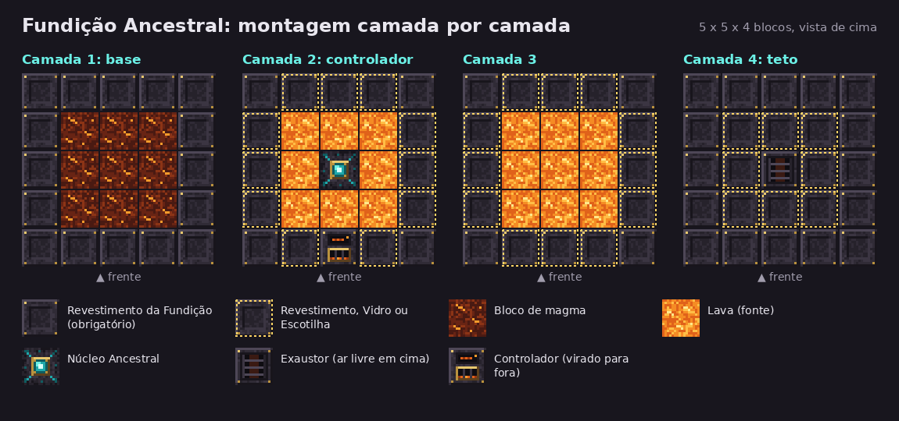

# Fundição Ancestral (Ancient Foundry)

Mod **Fabric** para **Minecraft 1.21.1** que adiciona uma máquina multibloco para farmar **fragmentos de netherita**. O drop é raro e lento de propósito: um fragmento a cada 17,5 minutos, em média. Em **12 horas ligada, a fundição rende 41 fragmentos, o bastante para 10 barras de netherita** (cada barra usa 4 fragmentos e 4 barras de ouro).

Precisa de [Fabric Loader](https://fabricmc.net/use/) e [Fabric API](https://modrinth.com/mod/fabric-api). Funciona em mundo solo e em servidor (no servidor, o mod vai no servidor e nos clientes).



## Como a máquina funciona

A fundição esmaga rocha do Nether com areia das almas sob calor extremo.

| | |
|---|---|
| Ciclo | 30 segundos; consome **1 rocha + 1 areia das almas** |
| Chance | a cada 35 ciclos, **um** é sorteado para soltar 1 fragmento (cerca de 2,9% por ciclo) |
| Garantia | cada rodada de 35 ciclos solta exatamente 1 fragmento: o momento é aleatório, a quantidade não |
| Aquecimento | 2 minutos queimando combustível até chegar a 1200 °C; abaixo disso a máquina não trabalha |
| 12 horas | 41 fragmentos partindo da máquina fria; o 40º sai no máximo com 11 h 42 min |

O intervalo entre dois fragmentos varia de 30 segundos a 34 minutos e meio. Como cada rodada sempre paga, azar não existe no longo prazo: 12 horas dão 10 barras, 120 horas dão 100.

### O que ela consome

- **Rocha do Nether** (1 por ciclo): basalto, basalto liso, basalto polido, pedra-negra ou netherrack.
- **Matéria das almas** (1 por ciclo): areia das almas ou solo das almas.
- **Combustível**: qualquer combustível de fornalha. Na fundição ele rende metade do tempo que renderia numa fornalha.

Para 12 horas seguidas: cerca de **22,5 pilhas de rocha**, **22,5 pilhas de areia das almas** e, de combustível, **108 blocos de carvão** (ou 87 baldes de lava, ou 720 varas de blaze, ou 432 blocos de alga seca).

Sem ingredientes ou com a saída cheia, a fundição para de pegar combustível e esfria sozinha. Ela só trabalha com o chunk carregado.

## Blocos

| Bloco | Receita | Onde vai |
|---|---|---|
| **Revestimento da Fundição** (x4) | 4 tijolos de pedra-negra polida nos cantos, 4 barras de ferro nos lados, 1 bloco de magma no centro | Base, quinas, paredes e teto |
| **Vidro da Fundição** (x4) | 4 vidros em cruz com 1 revestimento no centro | No lugar do revestimento em paredes e teto, menos nas quinas |
| **Controlador da Fundição** | Revestimento nos 4 cantos; comparador em cima, diamantes dos lados, alto-forno no centro, bloco de redstone embaixo | Meio da parede da frente, uma camada acima da base |
| **Núcleo Ancestral** | Obsidiana chorona nos 4 cantos; blocos de ouro em cima e embaixo, blocos de magma dos lados, **1 detrito ancestral** no centro | Centro da câmara, cercado de lava |
| **Exaustor da Fundição** | 3 grades de ferro em cima; revestimento, fogueira das almas, revestimento no meio; revestimento, vazio, revestimento embaixo | Centro do teto, com ar livre em cima |
| **Escotilha de Entrada** | 1 revestimento + 1 funil (sem forma) | Parede ou teto |
| **Escotilha de Saída** | 1 revestimento + 1 liberador (sem forma) | Parede ou teto |

As receitas aparecem no livro de receitas quando você pega um tijolo de pedra-negra polida ou um revestimento.

## Montagem

A estrutura tem 5 x 5 de base e 4 de altura. Lista de materiais para a versão mais simples:

- 71 Revestimentos da Fundição (18 fabricações), menos os que você trocar por vidro ou escotilhas
- 9 blocos de magma e 17 baldes de lava
- 1 Núcleo Ancestral, 1 Exaustor e 1 Controlador
- Escotilhas à vontade (são opcionais: sem elas, você abastece pela tela do controlador)

Monte de baixo para cima, seguindo a imagem:

1. **Base**: anel de revestimento com 3 x 3 de blocos de magma dentro.
2. **Camada do controlador**: paredes em volta, o Núcleo Ancestral no centro e 8 fontes de lava ao redor dele. O Controlador fica no meio da parede da frente, virado para fora.
3. **Terceira camada**: paredes em volta e 9 fontes de lava.
4. **Teto**: revestimento, com o Exaustor no centro. Deixe o bloco acima do Exaustor vazio.

As quatro quinas verticais, a base e a borda do teto só aceitam revestimento. Nas outras posições de parede e de teto (tracejadas na imagem) pode ir revestimento, vidro ou escotilha.

**Clique com o botão direito no Controlador**: se a estrutura estiver errada, ele diz qual bloco falta, em que coordenada, e marca o lugar com partículas. Quando estiver certa, o visor do controlador muda de vermelho para âmbar e o clique abre a tela.

## Uso

Na tela do controlador: rocha e areia das almas nos dois espaços de cima, combustível embaixo. A coluna da esquerda mostra a temperatura (a máquina trabalha acima da marca branca), a seta mostra o ciclo e o painel escuro mostra o estado, o ciclo da rodada atual e o total de fragmentos já produzidos.

Para automatizar:

- **Escotilha de Entrada**: aponte funis ou liberadores para ela. Uma escotilha só já separa rocha, areia das almas e combustível; itens que a máquina não usa ficam no funil.
- **Escotilha de Saída**: encoste um baú, barril ou funil nela. Os fragmentos (e os baldes vazios, se o combustível for lava) são empurrados para lá.
- **Redstone**: sinal no Controlador pausa a máquina. Um comparador lê o quanto o inventário dela está cheio.

Uma fundição para 12 horas sem ninguém mexendo: um baú duplo de rocha, um de areia das almas e um baú com 2 pilhas de blocos de carvão, todos com funis apontados para escotilhas de entrada, mais um baú encostado na escotilha de saída.

## Configuração

O arquivo `config/ancient_foundry.json` é criado na primeira vez que o jogo abre com o mod. Vale o do servidor.

| Opção | Padrão | O que faz |
|---|---|---|
| `cycleTicks` | 600 | Duração de um ciclo em ticks (20 ticks = 1 segundo) |
| `cyclesPerScrap` | 35 | Ciclos por fragmento garantido |
| `warmupTicks` | 2400 | Ticks de combustível para chegar à temperatura de trabalho |
| `fuelEfficiencyPercent` | 50 | Rendimento do combustível em relação à fornalha |

Fragmentos em 12 horas = (864000 - `warmupTicks`) / (`cycleTicks` x `cyclesPerScrap`), arredondado para baixo.

As rochas e a matéria das almas aceitas são as tags de item `ancient_foundry:foundry_rock` e `ancient_foundry:foundry_soul`, que um datapack pode mudar.

## Compilar

Precisa do JDK 25 para rodar o Gradle (exigência do Fabric Loom); o mod é compilado para Java 21.

```
./gradlew build
```

O jar sai em `build/libs/`. O `build` também roda os testes:

- **Testes de unidade** da lógica de calor, combustível e sorteio (`src/test`), incluindo 300 simulações de 12 horas.
- **Testes dentro do jogo** (`src/gametest`), num servidor de teste: formação da estrutura nas 4 direções, cada tipo de bloco faltando, funil pela escotilha de entrada, saída para baú, pausa por redstone, a tela, e **864.000 ticks (12 horas) de um controlador real**, que precisam render pelo menos 40 fragmentos.

O GitHub Actions (`.github/workflows/build.yml`) repete tudo isso a cada push e ainda liga o jar empacotado num servidor Fabric de verdade, monta uma fundição por comandos e confere que ela forma e aquece.

As texturas são geradas por `tools/gen_textures.py` e os JSON por `tools/gen_resources.py`.

## Licença

MIT. Veja [LICENSE](LICENSE).
